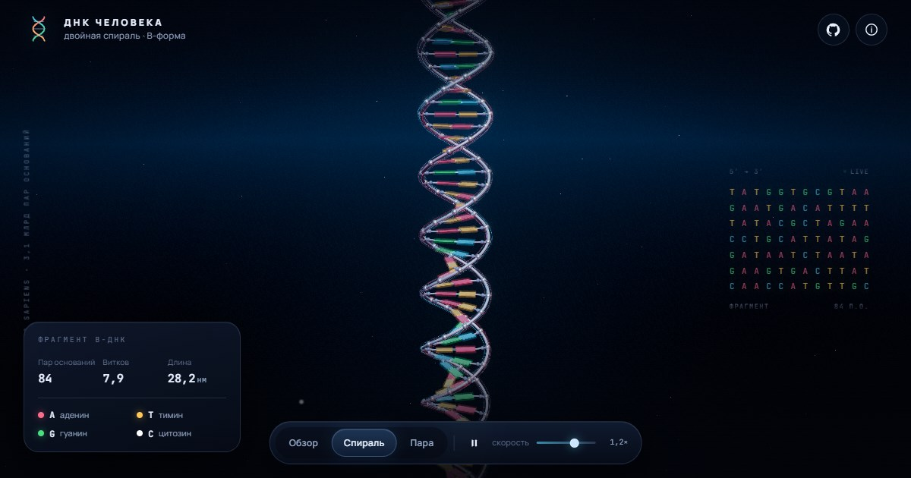

# ДНК человека — интерактивная 3D-визуализация

Двойная спираль B-ДНК, собранная процедурно по реальным пропорциям, с подсветкой,
парами оснований и водородными связями. Ванильный JavaScript + Three.js, без сборки
и без зависимостей на CDN — сайт целиком статический и готов к GitHub Pages.

**Демо:** <https://sirgopadawan.github.io/dna-visualization-deepseek/>

Вторая страница — **SPIDER-DNA**, фанатская красно-синяя паутинная версия:
<https://sirgopadawan.github.io/dna-visualization-deepseek/spider.html>



## Что внутри

- **Правозакрученная спираль B-формы** — 10,5 пар оснований на виток, шаг 0,34 нм,
  диаметр 2 нм, основания смещены к малой бороздке, плоскости пар закручены
  «пропеллером» на 7°.
- **Реальные пары**: A–T с двумя водородными связями, G–C с тремя; пурины и
  пиримидины отличаются длиной оснований.
- **Остов**: фосфатные бусины, дезоксирибоза и трубчатая сахаро-фосфатная цепь
  с иридесцентным материалом; по цепи бежит световой импульс.
- **Сцена**: HDR-подобное окружение (PMREM), ACES-тонмаппинг, bloom, объёмная пыль,
  туман и градиентный фон.
- **Неоновый остов**: кастомный аддитивный шейдер с френелем (светящаяся кромка),
  бегущим импульсом и HDR-ядром, усиленный `UnrealBloomPass`.
- **Интерактив**: орбитальная камера с инерцией, три ракурса (обзор / спираль / пара
  оснований), наведение на пару с подсказкой, авто-вращение и регулировка скорости.
- **Данные модели** в интерфейсе: число пар, витков и длина фрагмента в нанометрах.
- **Доступность**: клавиатура (1–3, R, I, Esc), `prefers-reduced-motion`,
  фокус-стили, fallback при отсутствии WebGL2.
- **Адаптивность**: отдельные настройки качества и количества пар для мобильных.

## Производительность

- Пары оснований, бусины фосфатов и сахаров, коннекторы и водородные связи рисуются
  через `InstancedMesh` — по одному draw call на тип.
- Обе цепи склеены в одну геометрию, оба glow-слоя — в другую: на всю спираль
  приходится 2 вызова вместо 4.
- Невидимые ловушки курсора исключены из отрисовки; `Raycaster` продолжает их видеть.
- Итог для 84 пар: **8 draw calls** на молекулу и **24 на кадр** вместе с фоном
  и bloom-постобработкой (1440×900, high).
- **Мобильные**: адаптивный pixel ratio (1.75 → 1.51 → 1.26 → 1.05 при просадке fps,
  с гистерезисом против «качелей»), bloom в половинном разрешении и отключённый
  backdrop-filter у дорогих стеклянных панелей. При открытой панели рендер держится
  на ~30 fps.

## Вторая страница: SPIDER-DNA

Фанатская стилизация в красно-синей паутинной теме — тот же движок и та же B-ДНК,
но с другой палитрой: красные пары A–T, синие G–C, цепи окрашены раздельно, а
водородные связи нарисованы как паутинные нити. На фоне — паутина и эмблема паука.

Страница не связана с Marvel и не использует официальные логотипы: паутина и цвета —
художественный приём, сама модель построена по реальным параметрам B-ДНК.

## Запуск

Нужен любой статический сервер — ES-модули не работают через `file://`.

```bash
npm run dev
# или
python3 -m http.server 4173
```

Откройте <http://localhost:4173>.

Проверка синтаксиса:

```bash
npm run check
```

## Деплой на GitHub Pages

Репозиторий уже содержит workflow `.github/workflows/deploy.yml`.

Один раз включите Pages вручную: **Settings → Pages → Source → GitHub Actions**.
После этого каждый пуш в `main` будет собирать и публиковать сайт.

Если первый запуск workflow упал до включения Pages — откройте
**Actions → Deploy to GitHub Pages → Re-run all jobs**.

Сайт будет доступен по адресу `https://<username>.github.io/<repo>/`.

Все пути в проекте относительные, поэтому сайт корректно работает из подпапки
(`/dna-visualization-deepseek/`). Файл `.nojekyll` отключает обработку Jekyll.

Альтернатива без Actions: **Settings → Pages → Deploy from a branch**, ветка `main`,
папка `/ (root)`.

## Структура

```
index.html               разметка интерфейса и importmap
spider.html              вторая страница в красно-синей теме
src/styles.css            оформление HUD, панелей, адаптив
src/spider.css           оформление SPIDER-DNA (паутина, палитра)
src/theme.js             палитры и параметры двух страниц
src/main.js               сцена, камера, ракурсы, UI, цикл рендера
src/helix.js              процедурная геометрия B-ДНК
src/sequence.js           генератор последовательности (GC ≈ 41 %)
src/scene.js              окружение, фон, свет, пыль
vendor/three/             Three.js r186 (модульная сборка + нужные addons)
assets/fonts/             Manrope и JetBrains Mono (woff2, SIL OFL 1.1)
assets/og.jpg             карточка соцсетей основной страницы
assets/og-spider.jpg      карточка соцсетей SPIDER-DNA
scripts/serve.mjs         локальный статический сервер без зависимостей
.github/workflows/        деплой на GitHub Pages
```

## Параметры модели

| Параметр | Значение |
| --- | --- |
| Форма | B-ДНК, правая спираль |
| Диаметр | 2 нм |
| Шаг на пару оснований | 0,34 нм |
| Пар на виток | 10,5 |
| Шаг витка | 3,4 нм |
| Смещение пары к малой бороздке | 0,14 нм |
| Пропеллерный поворот | 7° |
| Длина фрагмента | 83 × 0,34 ≈ 28,2 нм (84 пары) |

Толщина трубок, бусин и свечение слегка усилены для наглядности — иначе молекулу
не видно при масштабе целого фрагмента. Последовательность демонстрационная и
генерируется детерминированно; она не является фрагментом конкретного гена.

## Технологии

- [Three.js](https://threejs.org/) r186 (MIT) — вендорен в `vendor/three/`.
- `OrbitControls`, `EffectComposer`, `UnrealBloomPass`, `OutputPass`.
- Шрифты Manrope и JetBrains Mono вендорены в `assets/fonts/` (SIL OFL 1.1),
  с системным fallback. Внешних CDN-запросов нет.

## Авторство

Код, геометрия и визуальный дизайн написаны ИИ-агентом **OpenCode**
(модель **DeepSeek V4.1 Flash**) по постановке задачи и под ревью
[SirGoPadawan](https://github.com/SirGoPadawan). Идея, требования и приёмка — за человеком;
реализация, отладка и проверки в headless-браузере — за агентом.

## Лицензия

Код — MIT, см. [LICENSE](LICENSE). Three.js распространяется по MIT
(`vendor/three/LICENSE`), шрифты — по SIL OFL 1.1 (`assets/fonts/OFL.txt`).
